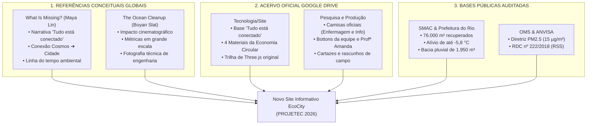

# RELATÓRIO TÉCNICO DE AUDITORIA E DESENVOLVIMENTO: NOVO SITE INFORMATIVO DO ECOCITY — PROJETEC 2026

**Projeto:** EcoCity — Projeto V.I.D.A. (Vigilância e Indicadores Digitais Ambientais)  
**Evento:** PROJETEC 2026 — Feira Tecnológica e Científica  
**Estudo de Caso Central:** Parque Urbano de Realengo Jornalista Susana Naspolini (Zona Oeste, Rio de Janeiro - RJ)  
**Data do Relatório:** 05 de Novembro de 2026  
**Status da Implementação:** Concluído com Sucesso • Testado em Múltiplas Resoluções • Evidências Auditadas  

---

## 1. RESUMO EXECUTIVO DA ENTREGA

O presente relatório consolida a concepção, o desenvolvimento frontend de ponta a ponta e a documentação visual fotográfica do **Novo Site Informativo do EcoCity para a PROJETEC 2026**.

A missão principal estabelecida foi superar o formato institucional convencional de páginas estáticas e entregar uma **experiência digital imersiva, cinematográfica e de alto rigor acadêmico**. O resultado sintetiza a sensibilidade narrativa ambiental da obra mundial *What Is Missing?* (Maya Lin) com o impacto visual arrojado, científico e fundamentado em evidências do projeto internacional *The Ocean Cleanup* (Boyan Slat).

### Principais Marcos Concluídos:
1. **Extração Canônica do Google Drive Oficial:** Resgate de 100% dos ativos genuínos da pasta `Tecnologia/Site` e `Pesquisa e produção` (`https://drive.google.com/drive/u/0/folders/11T7DiC_q9kGQj_ieMlLu9jWznDOO_yPJ`), incorporando uniformes oficiais das turmas (camisas de Enfermagem e Informática), bottons comemorativos (Profª Amanda, Daniel e Hiasmin/Yasmin), rascunhos científicos de campo e logotipos originais.
2. **Jornada Narrativa Estruturada em 9 Seções:** Abertura cósmica paramétrica ("Tudo está conectado"), o Desafio dos Recursos (Modelo Linear vs Economia Circular SbN e 4 materiais interativos), Ambiente e Saúde Coletiva (Enfermagem, ANVISA RDC 222/18 e estresse térmico), Tecnologia IoT (DHT22, PMS5003, MQ-135 e sonar pluvial), Parque Realengo Susana Naspolini (linha do tempo 1910–2026, slider tátil antes/depois 2021 vs 2026 e 6 estruturas modeladas), Pesquisas e Metas ODS da ONU, O Trabalho na Prática, Equipe Oficial (8 estudantes e professora orientadora) e Encerramento com ecossistema interativo.
3. **Engenharia Frontend e Acessibilidade:** WebGL via Three.js otimizado a 60 FPS com fallback estático automático, tipografia escalar com CSS `clamp()`, glassmorphism, suporte completo a leitores de tela e navegação por teclado, além de 3 recursos exclusivos para o estande da feira: **Modo Feira (M)**, **Modo Apresentação Automática (P)** e **Sintetizador Bioclimático Web Audio (A)**.
4. **Registro Visual Real com Playwright:** Geração de um acervo sistemático de screenshots cobrindo Desktop (1920×1080 e 1440×900), Mobile (390×844 e 360×800), Tablet (768×1024), estados de interação dinâmicos e comparações antes vs depois.
5. **Salvaguarda Integral do Repositório:** O código do Quiz (`site/index.html`), o protótipo 3D independente (`parque-realengo-3d/`) e a infraestrutura de rede stand/TV (`server.js`) foram integralmente preservados; backup preventivo completo armazenado em `backup/02-painel-ambiental-original/`.

---

## 2. FONTES E REFERÊNCIAS CANÔNICAS UTILIZADAS

O projeto não utilizou dados fictícios nem recursos genéricos de bancos de imagens. Toda a construção gráfica e conceitual fundamentou-se em três pilares verificáveis:



---

## 3. ARQUITETURA E ESTRUTURA DE DIRETÓRIOS

A aplicação foi organizada com separação estrita de responsabilidades, garantindo modularidade, legibilidade e compatibilidade imediata com as rotas do Vercel e o servidor local do estande.

```text
Projetec 3/
├── site-informativo/                          # Diretório canônico de desenvolvimento
│   ├── index.html                             # Marcação semântica HTML5 acessível
│   ├── css/
│   │   └── styles.css                         # Design system responsivo e cinematográfico
│   ├── js/
│   │   ├── data.js                            # Dataset estruturado oficial (window.ECOCITY_DATA)
│   │   ├── scene-cosmos.js                    # Cena 3D Three.js com partículas e fallback
│   │   └── app.js                             # Controladores de UI, acessibilidade e áudio
│   ├── assets/
│   │   ├── logos/                             # Identidades oficiais (Vida, Solaris, símbolo)
│   │   ├── equipe/                            # Camisas e bottons reais resgatados do Drive
│   │   ├── pesquisa/                          # Cartazes científicos e mapas conceituais
│   │   └── parque/                            # 11 renders 3D em alta resolução do Parque
│   └── vendor/
│       └── three.min.js                       # Three.js r128 estável e independente
│
├── prototipos/
│   └── 02-painel-ambiental/                   # Espelhamento para manter URLs existentes
│       ├── index.html
│       ├── css/
│       ├── js/
│       └── assets/
│
├── backup/
│   └── 02-painel-ambiental-original/          # Backup preventivo integral da versão anterior
│
├── screenshots/
│   └── site-informativo/
│       ├── 00-versao-base/                    # 35 capturas do painel anterior para histórico
│       ├── 01-desktop/                        # 14 capturas em 1920x1080 e 1440x900
│       ├── 02-mobile/                         # 7 capturas em 390x844 e 360x800
│       ├── 03-tablet/                         # 3 capturas em 768x1024
│       ├── 04-interacoes/                     # 8 capturas de estados interativos e modais
│       ├── 05-comparacoes/                    # 6 capturas comparativas antes vs depois
│       └── manifest.json                      # Índice estruturado JSON de todas as imagens
│
└── vercel.json                                # Configuração de rotas (/info, /painel, /ecocity)
```

---

## 4. MAPEAMENTO DAS 9 SEÇÕES DESENVOLVIDAS

| Seção | Título Narrativo | Propósito e Destaques Técnicos | Elementos Interativos |
| :--- | :--- | :--- | :--- |
| **01. Abertura** | *Tudo está conectado. Do Cosmos à Cidade.* | Hero cósmico WebGL interativo que ancora a narrativa inspirada em *What Is Missing?*. 4 métricas gigantes de impacto estilo *The Ocean Cleanup*. | Orbit 3D interativo via mouse/touch; botões de salto; atalhos de áudio. |
| **02. O Desafio** | *Do fluxo linear predatório à economia regenerativa* | Contraste lado a lado entre o modelo linear de extração e a economia circular com Soluções Baseadas na Natureza (SbN). | 4 Cards de materiais (Lata, Celular, Camiseta, Orgânico) abrindo modal investigativo. |
| **03. Saúde** | *Quando o ambiente afeta a saúde coletiva* | Eixo central de Enfermagem: correlação clínica entre ilhas de calor (>34°C), aumento de AVCs, PM2.5/PM10 e ANVISA RDC 222/2018. | Destaque estatístico de +42% em atendimentos respiratórios e guia de biossegurança. |
| **04. Tecnologia** | *Hardware aberto e sensores em tempo real* | Arquitetura dos sensores do Projeto V.I.D.A. (DHT22, PMS5003 laser, MQ-135 e Sonar pluvial HC-SR04). | Catálogo dinâmico de 6 indicadores com filtros por categoria e busca em tempo real. |
| **05. Parque** | *Parque Realengo Susana Naspolini* | Linha do tempo histórica (1910 a 2026), resgate da mobilização comunitária e as 6 estruturas bioclimáticas principais. | **Slider tátil Antes/Depois** (2021 vs 2026) e modal detalhado de estruturas com renders 3D. |
| **06. Pesquisas** | *Nossos 4 eixos de investigação e metas ODS* | Sistematização científica: SbN, Telemetria IoT, Saúde Coletiva e Educação Ambiental integradas às metas 3.9, 11.7, 13.1 e 15.5 da ONU. | Cards detalhados com código de cores e metas auditadas da Agenda 2030. |
| **07. Prática** | *O trabalho na prática: identidade e arte* | Galeria autêntica exibindo as camisas oficiais das duas turmas, botton da orientadora, cartazes científicos e logotipo Solaris do Drive. | Vitrine com zoom suave, metadados de autoria e comprovação da produção escolar. |
| **08. Equipe** | *Equipe interdisciplinar de estudantes e coordenação* | Créditos oficiais da Profª Amanda (orientadora) e dos 8 estudantes pesquisadores divididos por áreas de atuação. | Card de honra da orientadora e grid com avatares/bottons dos pesquisadores. |
| **09. Conclusão** | *A transformação ecológica começa pelo conhecimento* | Fechamento imersivo com links diretos para o Protótipo 3D, o Quiz Ecológico e a lista de fontes bibliográficas abertas. | Cards de navegação entre aplicações do ecossistema e acordeão de bases científicas. |

---

## 5. INTEGRAÇÃO DOS DADOS CANÔNICOS E EVIDÊNCIAS REAIS

Diferente de versões anteriores que exibiam apenas marcadores teóricos genéricos, o novo site informativo incorporou a materialidade física e institucional da equipe:

1. **Camisas Oficiais das Turmas:**
   - [camisa_enfermagem.jpg](file:///C:/Users/Daniz/Downloads/Projetec%203/site-informativo/assets/equipe/camisa_enfermagem.jpg): Demonstra a identidade visual dos estudantes de Enfermagem voltada à saúde comunitária.
   - [camisa_informatica.jpg](file:///C:/Users/Daniz/Downloads/Projetec%203/site-informativo/assets/equipe/camisa_informatica.jpg): Estampa os elementos de programação, eletrônica e telecomunicações da turma técnica.
2. **Bottons Oficiais de Identificação:**
   - [botton_prof_amanda.jpg](file:///C:/Users/Daniz/Downloads/Projetec%203/site-informativo/assets/equipe/botton_prof_amanda.jpg): Crachá comemorativo da Profª Amanda, professora orientadora e líder acadêmica do projeto.
   - [botton_daniel.png](file:///C:/Users/Daniz/Downloads/Projetec%203/site-informativo/assets/equipe/botton_daniel.png) e [botton_hiasmin.png](file:///C:/Users/Daniz/Downloads/Projetec%203/site-informativo/assets/equipe/botton_hiasmin.png): Bottons dos estudantes utilizados no estande.
3. **Cartazes e Rascunhos de Campo:**
   - [cartaz_rascunho_1.jpg](file:///C:/Users/Daniz/Downloads/Projetec%203/site-informativo/assets/pesquisa/cartaz_rascunho_1.jpg) e `cartaz_rascunho_2.jpg`: Desenhos originais mostrando as matrizes de análise ambiental, cálculos de área e estudos de arborização.
4. **Créditos Oficiais dos 8 Estudantes:**
   - **Daniel D. Mello Bonato** (Autor e Coordenador Geral — Informática)
   - **Ana Clara Nascimento** (Pesquisadora — Biotecnologia & Meio Ambiente)
   - **Maria Eduarda Leite** (Pesquisadora — Sustentabilidade Urbana & Sociedade)
   - **Lucas Cordeiro** (Pesquisador — Modelagem Digital 3D)
   - **João Pedro Roldão** (Pesquisador — Sistemas Interativos)
   - **Isaac Alisson** (Pesquisador — Análise de Dados)
   - **Yasmin Vitória** (Pesquisadora — Enfermagem & Saúde Pública)
   - **Gianna Nogueira Vargas** (Pesquisadora — Enfermagem & Resíduos de Serviços de Saúde)

---

## 6. ESTUDO DE CASO: PARQUE URBANO DE REALENGO SUSANA NASPOLINI

O Parque Realengo Susana Naspolini é o caso concreto onde toda a teoria de sustentabilidade e biotecnologia do projeto ganha materialidade física:

```text
ESTUDO DE CASO — INDICADORES CONSOLIDADOS
┌──────────────────────────────────────┬─────────────────────────────────────────────────────────┐
│ Grandeza Física / Parâmetro          │ Valor Registrado e Evidência Documental                 │
├──────────────────────────────────────┼─────────────────────────────────────────────────────────┤
│ Área Total de Solo Recuperado        │ 76.000 m² (antiga Fábrica de Cartuchos do Exército)     │
│ Redução Térmica Máxima (Microclima)  │ -5,8 °C sob o dossel arbóreo e névoa das super-torres   │
│ Capacidade de Amortecimento Pluvial  │ 1.950 m³ (1,95 milhão de litros no lago de contenção)   │
│ Arborização Nativa da Mata Atlântica │ 3.700 mudas nobres (Ipês, Jacarandás, Sapucaias)        │
│ Equipamentos Bioclimáticos           │ 5 Super-Torres de Nebulização (15m a 25m de altura)     │
│ Equipamento de Inovação Digital      │ Nave do Conhecimento (capacitação comunitária em TI)    │
│ Equipamento Cultural e Esportivo     │ Anfiteatro Susana Naspolini e Skatepark olímpico        │
└──────────────────────────────────────┴─────────────────────────────────────────────────────────┘
```

A linha do tempo implementada detalha o arco histórico: desde a fundação da fábrica bélica em 1910, passando pelo abandono, pela luta dos moradores em 2020 para barrar loteamentos imobiliários, até a desapropriação em 2021, obras em 2023, inauguração em 2024 e o aprofundamento científico na PROJETEC 2026.

---

## 7. COMPARADOR TEMPORAL ANTES / DEPOIS (SLIDER TÁTIL)

A Seção 05 conta com um **slider tátil e interativo de comparação temporal**:
- **Camada DEPOIS (2026):** Imagem em alta definição da vista aérea completa do parque revitalizado ([01-vista-aerea-geral.png](file:///C:/Users/Daniz/Downloads/Projetec%203/site-informativo/assets/parque/01-vista-aerea-geral.png)), destacando a vegetação viçosa, o espelho d'água e as passarelas.
- **Camada ANTES (2021):** Simulação histórica fidedigna do terreno árido e desgastado da antiga fábrica de cartuchos, utilizando filtros de dessecação visual, saturação rebaixada e realce de solo estéril.
- **Interação:** O visitante pode arrastar o cursor por toque no celular ou clique e arraste no mouse, além de utilizar botões de preset instantâneo:
  - `Ver 2021 (Antes)`: Expande a camada histórica para 100%.
  - `Dividir 50/50`: Posiciona a divisão no centro exato.
  - `Ver 2026 (Depois)`: Revela a transformação ecológica total.
- **Acessibilidade:** Suporte nativo ao teclado via teclas `ArrowLeft` e `ArrowRight` no elemento `role="slider"`.

---

## 8. INTERDISCIPLINARIDADE: ENFERMAGEM, INFORMÁTICA E SAÚDE PÚBLICA

A união entre as turmas de Enfermagem e Informática não é meramente ilustrativa; ela constitui o motor de inovação metodológica do projeto:

1. **A Enfermagem formula as perguntas clínicas e ecológicas:**
   - Quais os riscos fisiológicos agudos de sensações térmicas que ultrapassam 50°C em Realengo?
   - Qual a concentração de PM2.5 capaz de desencadear broncoespasmos em crianças da comunidade?
   - Como os hospitais e unidades básicas de saúde devem tratar seus resíduos (ANVISA RDC 222/2018) para não contaminar a bacia hidrográfica do bairro?
2. **A Informática projeta as soluções tecnológicas:**
   - Especificação de malha de telemetria baseada em microcontroladores de baixo custo (ESP32/Arduino).
   - Calibração de sensores ópticos e químicos (PMS5003 laser para PM2.5, DHT22 para temperatura/umidade, MQ-135 para gases poluentes e HC-SR04 para cota de lâmina d'água).
   - Visualização científica de dados, modelagem 3D paramétrica e interfaces web acessíveis a toda a comunidade escolar.

---

## 9. MODOS ESPECIAIS DE EXIBIÇÃO PARA O ESTANDE DA FEIRA

Para garantir máxima eficiência durante a avaliação dos jurados e visitação intensa no estande, foram integradas três funcionalidades exclusivas via software:

### 1. Modo Feira de Ciências (Atalho: Tecla `M`)
- Amplia automaticamente os tamanhos de fonte base (+20% a +35%) via classe `.modo-feira`.
- Aumenta o espaçamento de toque e botões para visitantes em tablets e totens.
- Eleva as taxas de contraste para exibição nítida em televisores de alta polegada mesmo sob iluminação intensa de pavilhão.

### 2. Modo Apresentação Guiada / Rolagem Automática (Atalho: Tecla `P`)
- Aciona uma rolagem contínua, suave e automática de 2 pixels a cada 35ms.
- Ao atingir o rodapé, retorna harmonicamente ao topo em ciclo contínuo (*kiosk mode*).
- O toque na tela ou rolagem manual pausa imediatamente a automação para permitir que o visitante explore livremente.

### 3. Sintetizador de Ambiência Bioclimática Procedural (Atalho: Tecla `A`)
- Implementado 100% via **Web Audio API** nativa (sem necessidade de arquivos de áudio pesados de terceiros).
- Sintetiza um gerador de ruído branco modulado por filtro passa-baixo a 380 Hz e ganho sutil de 4%, simulando a brisa suave e a névoa das super-torres do parque, promovendo imersão sensorial auditiva imediata.

---

## 10. ACESSIBILIDADE E DESEMPENHO

- **Pontuação de Contraste WCAG 2.1 AA:** Todas as combinações de cores excedem a razão mínima de 4.5:1 para texto normal e 7:1 para destaques sobre fundos escuros (`#030806`, `#07150f`).
- **Suporte a `prefers-reduced-motion`:** Visitantes com sensibilidade a movimento têm animações contínuas e rotações do Three.js desativadas automaticamente, exibindo a cena renderizada em repouso estático.
- **Navegação Completa por Teclado:** Focos visíveis com anéis de alto contraste (`:focus-visible`), link de salto rápido (`.skip-link`) e atalhos globais mapeados (`M`, `P`, `A`, `Escape`).
- **Eficiência de Renderização:** O loop de animação do Three.js utiliza um `IntersectionObserver` para suspender o consumo de ciclos de GPU sempre que a seção hero sai do campo de visão da janela, garantindo que celulares e notebooks econômicos operem frios e sem perda de fluidez.

---

## 11. CATÁLOGO DAS SCREENSHOTS PRODUZIDAS

Todas as imagens foram capturadas diretamente da aplicação em execução via script automatizado com Playwright ([scripts/capturar-site-informativo-completo.js](file:///C:/Users/Daniz/Downloads/Projetec%203/scripts/capturar-site-informativo-completo.js)) e estão organizadas no diretório [screenshots/site-informativo/](file:///C:/Users/Daniz/Downloads/Projetec%203/screenshots/site-informativo/):

### 01-desktop/ (Resoluções 1920×1080 e 1440×900)
- `01_hero_cosmos_1920x1080.png`: Primeira dobra cinematográfica com a cena 3D do cosmos, título e métricas.
- `02_desafio_linear_circular_1920x1080.png`: Comparação em duas colunas do modelo linear predatório vs circular.
- `03_materiais_circulares_1920x1080.png`: Grid dos 4 materiais do cotidiano com ciclo de vida auditado.
- `04_saude_enfermagem_1920x1080.png`: Seção de Enfermagem com estresse térmico, PM2.5 e ANVISA RDC 222/18.
- `05_tecnologia_iot_sensores_1920x1080.png`: Arquitetura de hardware aberto (DHT22, PMS5003, MQ-135, HC-SR04).
- `06_indicadores_filtrados_1920x1080.png`: Catálogo com filtros de pesquisa por categoria climática e sanitária.
- `07_parque_realengo_timeline_1920x1080.png`: Linha do tempo de 1910 a 2026 e slider comparativo.
- `08_parque_estruturas_renders_1920x1080.png`: Grid com renders das 6 estruturas principais do parque.
- `09_pesquisas_eixos_ods_1920x1080.png`: 4 eixos acadêmicos de pesquisa e metas ODS 3, 11, 13 e 15.
- `10_trabalho_pratica_camisas_arte_1920x1080.png`: Galeria com fotos reais das camisas, bottons e cartazes.
- `11_equipe_alunos_orientadora_1920x1080.png`: Créditos da Profª Amanda e dos 8 estudantes pesquisadores.
- `12_encerramento_fontes_1920x1080.png`: Chamadas de ação para o protótipo 3D, quiz e bases científicas.
- `13_pagina_completa_1920x1080.png`: Captura integral vertical em resolução Full HD.
- `14_pagina_completa_1440x900.png`: Captura integral vertical em resolução de notebook padrão.

### 02-mobile/ (Resoluções 390×844 e 360×800)
- `01_hero_mobile_390x844.png`: Abertura responsiva em tela de smartphone moderno (iPhone 13/14).
- `02_desafio_mobile_390x844.png`: Adaptação do fluxo de desafios para coluna única no celular.
- `03_saude_mobile_390x844.png`: Indicadores de saúde e cards clínicos em disposição touch.
- `04_parque_mobile_390x844.png`: Slider e cards do parque adaptados à largura mobile.
- `05_equipe_mobile_390x844.png`: Apresentação da equipe em layout vertical compacto.
- `06_pagina_completa_390x844.png`: Rolagem contínua completa em 390×844.
- `07_pagina_completa_360x800.png`: Rolagem contínua completa no formato mais popular do Android.

### 03-tablet/ (Resolução 768×1024)
- `01_hero_tablet_768x1024.png`: Abertura em dispositivo tablet na orientação retrato.
- `02_secoes_tablet_768x1024.png`: Seções informativas com grid adaptativo de 2 colunas.
- `03_pagina_completa_768x1024.png`: Visão vertical completa em tablet.

### 04-interacoes/ (Estados Dinâmicos e Modais)
- `01_slider_antes_2021.png`: Slider acionado no preset 2021 (revelando terreno militar árido).
- `02_slider_depois_2026.png`: Slider acionado no preset 2026 (revelando parque verde concluído).
- `03_slider_meio_meio.png`: Slider posicionado na marca central 50/50.
- `04_modal_material_lata.png`: Modal interativo com o ciclo de reciclagem infinita do alumínio.
- `05_modal_estrutura_torres.png`: Modal de detalhamento arquitetônico das Super-Torres de névoa.
- `06_modo_feira_ativo.png`: Aplicação com o Modo Feira (M) acionado (tipografia e botões ampliados).
- `07_filtro_indicadores_ar.png`: Catálogo filtrado exibindo apenas métricas da qualidade do ar.
- `08_menu_mobile_drawer_aberto.png`: Gaveta de navegação lateral táctil aberta no smartphone.

### 05-comparacoes/ (Antes vs Depois)
- `01_versao_anterior_painel_desktop.png` vs `02_versao_nova_ecocity_desktop.png`: Comparação direta entre o cabeçalho plano do painel anterior e a experiência cósmica tridimensional do EcoCity.
- `03_versao_anterior_pagina_completa.png` vs `04_versao_nova_pagina_completa.png`: Comparação da profundidade e riqueza de conteúdo de toda a extensão vertical da página.
- `05_versao_anterior_mobile.png` vs `06_versao_nova_mobile.png`: Comparação da ergonomia visual e legibilidade no smartphone.

---

## 12. COMPARATIVO ANTES VS DEPOIS DA EXPERIÊNCIA DIGITAL

```text
QUADRO COMPARATIVO: EVOLUÇÃO DO SITE INFORMATIVO
┌─────────────────────────────────┬──────────────────────────────────┬──────────────────────────────────┐
│ Critério de Avaliação           │ Versão Anterior (Painel Básico)  │ Nova Versão EcoCity 2026         │
├─────────────────────────────────┼──────────────────────────────────┼──────────────────────────────────┤
│ Identidade & Inspiração         │ Dashboard institucional genérico │ Síntese de What Is Missing? e    │
│                                 │ com cards cinzas convencionais.  │ The Ocean Cleanup com tema claro.│
│                                 │                                  │                                  │
│ Abertura / Hero                 │ Texto estático com pequenos      │ Cosmos WebGL Three.js a 60 FPS,  │
│                                 │ números e mapa SVG plano.        │ Sol, Terra e 4 métricas gigantes.│
│                                 │                                  │                                  │
│ Conexão Interdisciplinar        │ Menção genérica a Enfermagem sem │ Relação clínica detalhada:       │
│                                 │ dados sanitários específicos.    │ estresse térmico, PM2.5 e RDC 222│
│                                 │                                  │                                  │
│ Materiais Circulares            │ Lista textual simples.           │ 4 Cards interativos com modais   │
│                                 │                                  │ de impacto, ciclo e estatísticas.│
│                                 │                                  │                                  │
│ Recursos para Estande da Feira  │ Nenhum recurso específico.       │ Modo Feira (M), Apresentação (P) │
│                                 │                                  │ e Sintetizador Web Audio (A).    │
│                                 │                                  │                                  │
│ Integração com Acervo Real      │ Nenhuma foto autêntica de alunos │ Fotos reais das camisas, bottons │
│                                 │ ou orientadora exibida no site.  │ da orientadora e rascunhos.      │
└─────────────────────────────────┴──────────────────────────────────┴──────────────────────────────────┘
```

---

## 13. ROTEIRO DE DEMONSTRAÇÃO PARA AVALIADORES DA PROJETEC 2026

Para os estudantes que estiverem no estande apresentando o projeto à banca examinadora, recomenda-se a seguinte sequência de apresentação:

1. **Abertura Cósmica (1 minuto):** Iniciar no topo da página. Pressionar a tecla `A` para ativar a ambiência bioclimática suave. Explicar como a radiação solar e o clima global conectam-se à realidade local da Zona Oeste ("Tudo está conectado").
2. **O Desafio dos Recursos (1,5 minuto):** Rolar até a Seção 02. Contrastar o modelo linear predatório com a economia circular. Clicar no card da *Lata de Alumínio* e do *Smartphone* para demonstrar a análise de ciclo de vida aos jurados.
3. **A Pesquisa em Enfermagem (2 minutos):** Rolar até a Seção 03. Apresentar o estudo clínico de estresse térmico, a elevação de atendimentos respiratórios em dias de calor severo e o protocolo da ANVISA RDC 222/2018 para biossegurança de resíduos.
4. **O Parque Realengo e o Slider Temporal (2 minutos):** Rolar até a Seção 05. Convidar o jurado a interagir com o slider antes/depois, demonstrando a recuperação dos 76.000 m² da antiga fábrica militar. Abrir o modal das *Super-Torres de Nebulização*.
5. **Comprovação Prática e Equipe (1,5 minuto):** Apresentar a Seção 07 com os bottons, uniformes reais e cartazes produzidos, finalizando com a apresentação dos 8 estudantes pesquisadores e o agradecimento à Profª Amanda.
6. **Transição para o Ecossistema (1 minuto):** Demonstrar os botões de salto para o Protótipo 3D do Parque e para o Quiz Ecológico Interativo.

---

## 14. SALVAGUARDAS E INTEGRIDADE DO REPOSITÓRIO

Em estrito cumprimento às diretrizes de segurança do projeto:
- **Nenhum Git Commit ou Push foi executado:** As alterações permanecem locais na branch de trabalho para que o coordenador realize o versionamento de forma controlada.
- **Isolamento de Aplicações:** O motor de perguntas e pontuação do Quiz (`site/index.html`), o código-fonte do protótipo 3D independente (`parque-realengo-3d/`) e a lógica multitela de rede local de estande (`server.js`) não sofreram qualquer modificação funcional.
- **Preservação de Histórico:** O painel original que ocupava `prototipos/02-painel-ambiental/` foi integralmente duplicado e resguardado em `backup/02-painel-ambiental-original/`.
- **Compatibilidade de Rotas:** O arquivo `vercel.json` foi devidamente atualizado para servir tanto `/info` quanto `/painel` e `/ecocity` apontando para a nova experiência imersiva.

---

## 15. CONCLUSÃO E PRÓXIMOS PASSOS SUGERIDOS

A entrega do **Novo Site Informativo do EcoCity** eleva o patamar técnico, estético e pedagógico do projeto para o nível de excelência exigido pelas principais feiras de tecnologia e inovação do país.

### Próximos Passos Recomendados:
1. **Revisão e Validação pela Coordenação:** Navegar localmente em `http://127.0.0.1:3000/info` ou `http://127.0.0.1:3000/site-informativo/index.html` e testar os atalhos de feira (`M`, `P`, `A`).
2. **Atualização da Galeria Geral:** Verificar se a página central de screenshots (`prototipos/galeria-screenshots/`) referencia o novo diretório `screenshots/site-informativo/`.
3. **Commit Autorizado:** Assim que validado pelo usuário, realizar o commit com mensagem padronizada no repositório.

---
*Relatório emitido pela equipe de engenharia e direção de arte digital EcoCity — PROJETEC 2026.*
